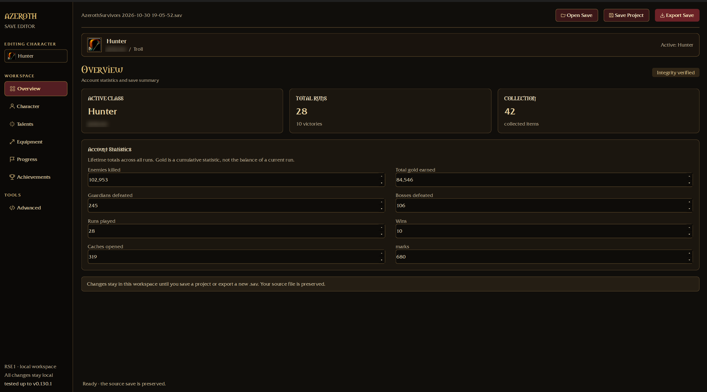
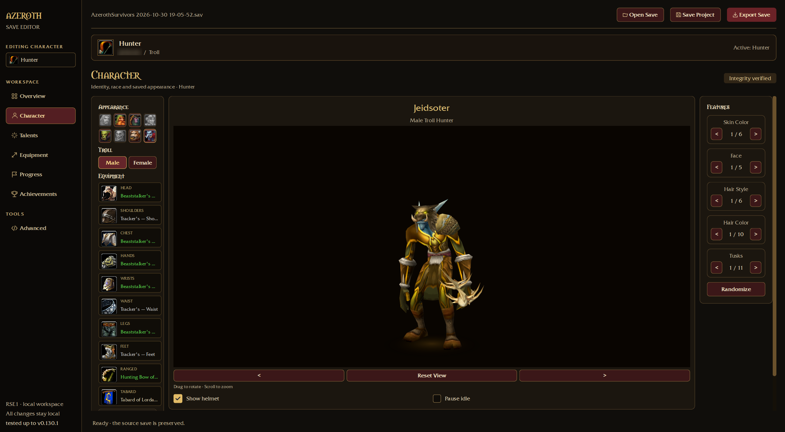
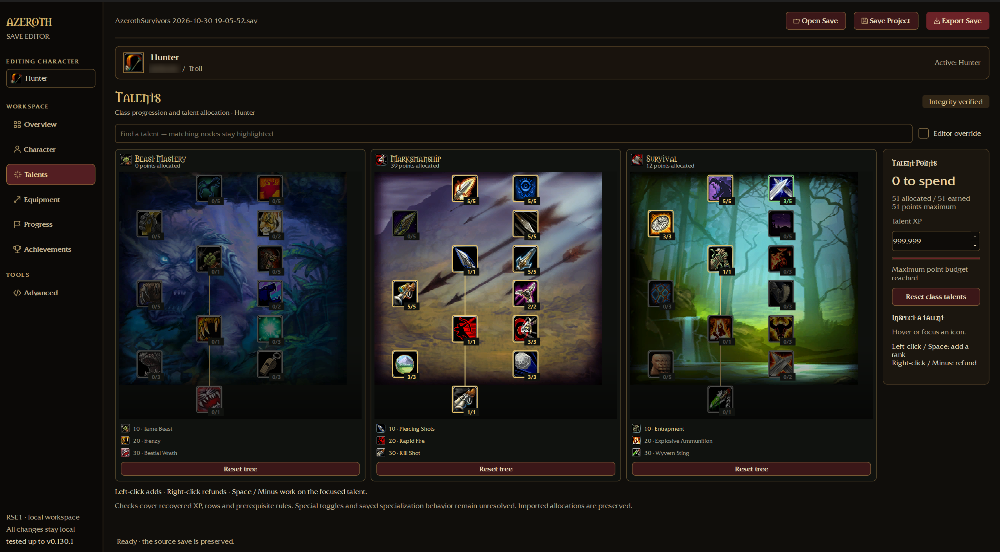
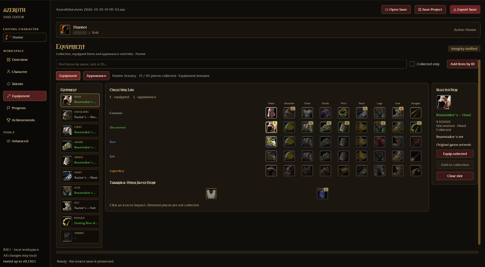

# Azeroth Survivors Save Editor

A standalone Windows application for opening encrypted Azeroth Survivors saves, editing character and account settings, and exporting a new save. Everything is processed locally.

## Download and first use

The executable is ready to run without installing a development environment.
[⬇ Download for Windows](https://github.com/jeidsoter/Azeroth-Survivors-Save-editor/releases/latest)

### Download and start

1. Open [GitHub Releases](https://github.com/jeidsoter/Azeroth-Survivors-Save-editor/releases).
2. Expand the release's **Assets** and download **AzerothSurvivorsSaveEditor.exe**.
3. Place the `.exe` in a folder of your choice and double-click it. No installer or administrator access is required. The first startup can take a little longer while the included runtime is unpacked.

If no executable release is listed yet, it has not been published.

### Requirements

- Windows 10/11, 64-bit, with a working graphics driver for the 3D preview.
- Your installed game files for original icons, fonts and character models. Basic save editing can run before assets are prepared.
- Approximately 135 MB for prepared character assets, plus the executable and temporary runtime files.

### First-run asset setup

The executable includes the tools needed to prepare artwork from your own game installation:

1. In the editor, select **Tools → Prepare Game Assets…**.
2. Click **Choose Game Folder and Prepare**.
3. Select the **game folder** containing both `AzerothSurvivors.exe` and the `Data` directory. Do not select the editor's folder or the `Data` subfolder itself.
4. Wait for all three stages: talent artwork, class/equipment/fonts, then character models/textures. The last stage can take several minutes; keep the dialog open until it finishes.
5. Close and reopen the editor after the completion message.

Preparation is needed once per local asset setup. It reads the original game files without modifying them and requires no network connection or additional software installation. Repeat it if you change game installations or need to repair missing assets. Preparation errors are shown in the dialog.

### Asset location and updates

Executable assets are stored under:

```text
%LOCALAPPDATA%\AzerothSurvivorsSaveEditor\
├── data\                     icons, backgrounds, fonts and metadata
└── .cache\character_assets\  character models, textures and derived atlases
```

These files are separate from your saves and from the executable's temporary runtime folder. Moving or replacing the `.exe` leaves the prepared assets in place. Download a newer executable from Releases and restart it; if artwork is missing, run **Prepare Game Assets** again. Keep saves and JSON drafts in a folder of your choice.

## Open, edit and export

1. Export a **fresh save from the game** and keep the untouched file separately.
2. Choose **Open Save**, or drag a `.sav` onto the editor. RSE1 format and authentication are checked before opening.
3. Choose the class to edit in the sidebar. Inspecting a class does not activate it; Character has a separate **Set Active** action.
4. Make explicit changes on the pages described below.
5. **Save Project** writes a readable `.azeroth.json` draft. Reopen it with **Open Save** to continue editing. Drafts contain decrypted account data and should stay private; they are not game-import files.
6. **Export Save** writes an authenticated encrypted `.sav` under a **new filename**. Export decrypts/verifies the result before an atomic write. It cannot overwrite the imported original.
7. Import the exported file through the game's own import UI. The account is replaced, not merged with progress earned since the export. Verify the result and keep your original backup.

Before opening another file or closing, the editor prompts about unsaved changes. Advanced text changes must be applied or discarded before export.

| Shortcut | Action |
|---|---|
| Ctrl+O | Open save or JSON draft |
| Ctrl+S | Save JSON draft |
| Ctrl+Shift+S | Export encrypted save |

## Page guide

### Overview

Edit cumulative account statistics. **Gold earned** is lifetime gold, not a spendable balance. Saved `hero` values describe identity/appearance, not a character level. The export does not contain current-run HP, position or a separate current level.

### Character

Select an allowed race using its portrait, choose sex, edit the name and use feature arrows/counters or **Randomize**. Feature labels and ranges come from native race/sex metadata. Only explicit edits write; imported unknown extra values retain their own record tails. **Set Active** changes the active class separately from inspecting a class.

Drag to rotate; scroll over the model to zoom. Arrow buttons rotate and **Reset View** resets the camera. **Show helmet** and **Pause idle** affect only the preview. Click an equipment slot to open that slot in Armory Appearance mode.

### Talents

All three trees stay visible. Hover/focus inspects details. Search highlights matches without moving nodes.

- Left-click, Space, Enter or Plus adds one rank.
- Right-click, Minus, Backspace or Delete refunds one rank. Tab moves focus.
- XP costs are `80 + 15*n` for the next point after `n` earned. The recovered cap is **51 points at 23,205 total XP**; extra XP does not raise it.
- Row `r` needs `5*r` points in strictly lower rows of that tree. Named prerequisites require maximum rank in an allowed alternative. Invalidating refunds are rejected.
- **Editor override** bypasses budget/row/prerequisite/exclusive-choice checks; rank maxima still apply. Unsupported allocations may be changed or rejected by the game.
- Reset actions remove known ranks in the chosen tree/class, preserving XP, unknown fields and other classes. Imported invalid allocations are displayed with warnings rather than silently repaired.

**Specialization limitation:** the editor does not yet synchronize `spec|` active-build records with edited `talent|` ranks. Saves using multiple specializations need this follow-up before talent-edit compatibility can be claimed. Auxiliary toggles/effect values also remain partly unresolved.

### Equipment

Choose **Equipment** or **Appearance**. Slot cards show saved choices; collection tiles show rarity and ownership. **E** marks equipped and **L** marks a cosmetic look. Search/Collected only highlight without writing or rearranging items.

Selecting a tile only inspects it. Use **Equip selected** or **Apply appearance** to write. For an uncollected item, use **Add to collection** first. Known assignments require class/slot compatibility. **Clear slot** removes that selected equipment entry; **Use equipped item** removes its cosmetic override. Tabards have separate ownership. Unknown IDs/slots stay preserved and visible; **Add Item by ID** adds ownership without inventing compatibility.

The verified catalog contains 417 records for the analyzed executable. Seven native display-zero starter items use labelled placeholders. Broader equipment tiers and exact bonus/drop rules are not fully reconstructed.

### Progress and Achievements

Progress has **Zones & Marks**, **Account Perks** and **Codex** tabs. Zone edits are class-scoped; perks/discoveries are account-scoped. Full game progression requirements are not enforced. The current UI can create progression for a class without initialized zone records; avoid that until the proposed initialization guard is implemented.

Achievements can be searched and toggled. Existing timestamps are retained; newly completed entries receive the current time. Removing completion also removes its timestamp. Rewards, statistics and unlock prerequisites are not recalculated automatically.

### Advanced

Inspect/edit the entire decrypted text, including unsupported fields. **Apply Text Changes** validates and replaces the document; **Discard Text Changes** restores it. Applying text changes normalizes line endings to LF. Ordinary form edits preserve untouched record order, opaque tokens and line endings. Raw editing requires understanding the format.

## Features

- Open authenticated RSE1 exports; save readable JSON drafts; export a new encrypted save with a fresh nonce and verified roundtrip.
- Game-style dark/gold/burgundy interface with persistent file and character context.
- Three interactive illustrated talent trees for each of nine classes, XP-derived points, search, prerequisites, rank limits, refunds and an explicit override. Trees grow vertically on large windows.
- Character Armory with original models for all eight races and both sexes, race/sex/features, gear preview, rotation, zoom and idle animation.
- Equipment and cosmetic appearance modes with item icons, collection ownership and class/slot checks.
- Statistics, zone completion, Marks, account perks, Codex and achievements, plus an Advanced text editor.
- Unknown records/tokens and other classes remain preserved during ordinary edits; original-file overwrite is blocked.

## Screenshots

### Main Interface



### Character Editor



### Talent Tree



### Equipment



## Troubleshooting and limits

- **No executable in Releases:** the Windows build has not been published yet. A Source code ZIP does not contain a prebuilt executable.
- **Blank icons, missing fonts or no model:** use **Tools → Prepare Game Assets…**, wait for completion and restart. Check that the selected game folder contains `AzerothSurvivors.exe` and `Data`.
- **Asset preparation fails:** read the error in the dialog and confirm the selected installation has its original game files. A different game build may require updated metadata or artwork mappings. Save editing does not repair missing game installation files.
- **3D preview unavailable:** check the graphics driver. Appearance controls remain usable when the preview cannot start.
- **Missing textures / approximate visuals:** some original Lordaeron tabard and Tauren hair/scalp references are absent. Warnings identify gaps. Lighting/blend behavior is approximate; particles, ribbons and some animated material effects are incomplete.
- **No points despite high XP:** the normal cap remains 51. Overrides are editor behavior, not proof of a larger game limit.
- **Export disabled:** apply or discard pending Advanced text. Always choose a new export filename.
- **Game ignores/reverts edits:** use a fresh game export and retain the original backup. Version, specialization and progression layouts may differ. Editor roundtrip tests do not establish that every edit is accepted or persisted by the game.

## Credits

Original game artwork belongs to its respective owners. Asset preparation reads your installed game files for local use. This unofficial editor is not affiliated with the game developer or Blizzard Entertainment.
